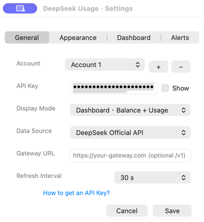
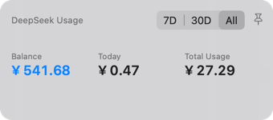
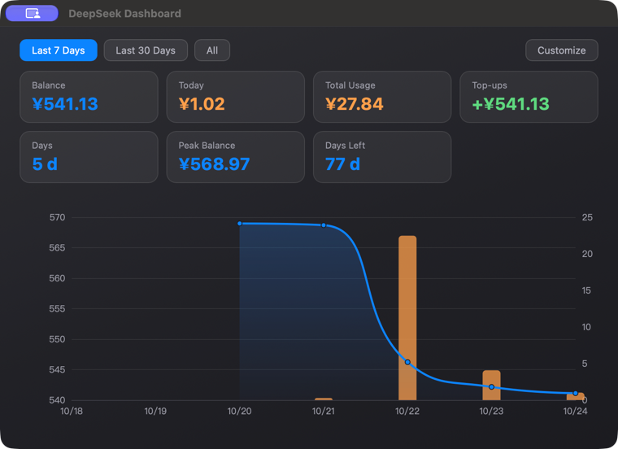

# DeepSeek 用量面板（DeepSeek Usage Panel）

> 常驻屏幕角落的 **DeepSeek / 智谱 AI（GLM）** 余额悬浮窗 + 桌面小组件 + 用量看板。
> 极简显示、实时刷新、支持官方 API、智谱 Coding Plan 与自建网关，macOS / Windows 双端开源。

English | [简体中文](./README.zh-CN.md)


## 功能一览

| 能力 | macOS | Windows |
|---|---|---|
| 悬浮窗（极简模式：只显示总余额大字） | ✅ | ✅ |
| 标准模式（总余额 + 赠送 + 充值） | ✅ | 🚧 规划中 |
| 看板模式（悬浮窗直接显示用量看板：卡片 + 曲线） | ✅ | 🚧 规划中 |
| 窗口始终置顶开关（可在设置中关闭） | ✅ | ✅ |
| 菜单栏常驻 / 系统托盘 | ✅ | ✅ |
| 菜单栏图标：单击弹菜单，双击弹出悬浮窗 | ✅ | — |
| 桌面小组件（WidgetKit） | ✅ | — |
| 用量看板（余额曲线 / 每日使用量 / 双轴对比，卡片可自定义） | ✅ | ✅ |
| 开机自启 | ✅ | 🚧 规划中 |
| 自定义网关（new-api / one-api） | ✅ | ✅ |
| 低余额提醒 | ✅ | 🚧 规划中 |
| 智谱 AI（GLM）余额 + Coding Plan | ✅ | ✅ |

## 快速开始

### 获取 API Key（首次使用）

应用需要 DeepSeek **API Key** 才能读取账号余额，Key 永远不会离开你的电脑。

1. 打开 [platform.deepseek.com](https://platform.deepseek.com) → **注册 / 登录**（邮箱或手机号均可）。
2. 余额为 0 时先**充值**少量金额（新账号平台会赠送少量额度）。
3. **API Keys → 创建新 API key** → 复制 `sk-…` 开头的字符串。
4. 启动应用——首次启动自动弹出设置窗口，粘贴 Key 并点击**保存**。

> 设置窗口底部有蓝色链接 **「如何获取 API Key？」**，点击直接打开官方 API Key 页面。完整图文教程见：[使用指南](./docs/USAGE-GUIDE.zh-CN.md) · [User Guide](./docs/USAGE-GUIDE.md)

| 设置界面 | 悬浮窗 | 用量看板 |
|---|---|---|
|  |  |  |

> 余额是**账号级**而非 Key 级——同一账号任意 Key 查到的都是同一个总余额。多账号可用设置里的 **+ / −** 按钮切换。

### 智谱 AI（GLM）支持

在**设置 → 数据源**中选择 **智谱 AI（GLM）**，粘贴智谱 API Key（`id.secret` 格式，在 [bigmodel.cn](https://bigmodel.cn/usercenter/proj-mgmt/apikeys) 创建）。悬浮窗会显示：

- **可用余额**（现金 + 赠送，人民币），来自财务总览接口
- **套餐**名称与**套餐到期**日（如 `GLM Coding Lite` / `2027-03-07`），来自当前有效订阅

账号之间完全隔离：每个账号各自记录余额历史，DeepSeek 与智谱来回切换不会再出现"突然消耗几百块"的假数据。

> 说明：智谱的套餐积分（5 小时 / 每周额度）没有开放的查询接口（该路径被网关拦截），因此应用展示套餐状态与到期日，而不是猜一个积分数字。

### macOS（macOS 13+）

```bash
cd apps/macos
./build.sh          # 编译主应用 + 小组件 + 看板（需要 Xcode 命令行工具）
open DeepSeekUsagePanel.app
```

首次启动会自动弹出设置，粘贴 API Key（`sk-…`）保存即可。之后程序常驻**菜单栏 ¥ 图标**：左键单击弹出菜单；左键**双击直接弹出悬浮窗**；菜单里有设置、用量看板、开机自启、退出。

**窗口置顶**：默认悬浮窗始终置顶；在「设置… → 窗口始终置顶」取消勾选后，悬浮窗会变为普通窗口层级，不再遮挡其他应用。

**数据存储**：配置与余额历史保存在 `~/Library/Application Support/DeepSeekUsagePanel/`（API Key 同时写钥匙串兜底）。macOS 本地开发使用非沙盒模式（ad-hoc 签名无 Apple Developer team id，App Group 与沙盒文件豁免均不可用）；**正式上架 App Store 时将恢复沙盒 + App Group**（届时桌面小组件可直接读取共享余额）。

**桌面小组件**（macOS 14+）：桌面右键 → 编辑小组件 → 搜索 **DeepSeek**，拖到桌面即可（小/中两种尺寸，每 15 分钟刷新）。

### Windows（Tauri 2）

```bash
cd apps/windows
npm install
npx tauri dev       # 开发运行
npx tauri build     # 打包 NSIS 安装包（产物在 src-tauri/target/release/bundle/nsis/）
```

Windows 端同样提供透明无边框悬浮窗 + 系统托盘 + 用量看板；数据存在 `%APPDATA%/deepseek-usage-app/`。

## 数据源与口径

- **官方接口**：`GET https://api.deepseek.com/user/balance`（Bearer Key 认证），返回账户级余额（充值 + 赠送合计）。**余额是账号级的，不分 Key**——任意 Key 查询都是同一账号总余额。
- **自定义网关**：兼容 new-api / one-api 等 OpenAI 风格网关，自动探测 `{网关}/user/balance` 与 `{网关}/v1/user/balance`，DeepSeek / OpenAI 两种返回格式都支持。
- **用量看板**：官方无"每日用量明细"公开接口（网页后台的用量数据是内部接口）。看板基于应用**本地记录的余额历史**计算两个维度：**余额**（曲线）与**使用量**（相邻两次余额的下降差 = 消耗，上升差 = 充值/赠送）。支持三种图表模式（余额趋势 / 每日使用量 / 余额+使用量双轴对比），数据卡片可自定义勾选（当前余额、今日消耗、累计消耗、累计充值、记录天数、区间最高余额），配置保存在看板本地（localStorage，跨端一致）。按 Key/按模型的每日明细需要自建网关记账（二期规划）。
- **低余额提醒**：总余额 < ¥20 变橙，< ¥5 变红。

## 安全与隐私

- API Key **只保存在本机**：macOS 存于 `~/Library/Application Support/DeepSeekUsagePanel/config.json` 并同步写钥匙串兜底；Windows 存于 `%APPDATA%/deepseek-usage-app` 本地文件。
- 应用**不采集、不上传任何数据**，所有请求仅指向你配置的 DeepSeek 官方地址或自建网关。
- 开源代码，Key 存储方式完全可见，可自行审计。

## 工程结构

```
deepseek-usage-app/
├── apps/
│   ├── macos/            # Swift/AppKit 原生（悬浮窗 + WidgetKit 小组件 + 看板窗口）
│   │   ├── DeepSeekUsagePanel.swift
│   │   ├── widget/       # WidgetKit 小组件扩展
│   │   └── build.sh      # 一键构建（arm64 + x86_64 + 签名）
│   └── windows/          # Tauri 2（Rust）：悬浮窗 + 系统托盘 + 看板
│       ├── src-tauri/    # Rust 后端 + tauri.conf.json
│       └── src/          # 前端（悬浮窗 / 设置页）
├── shared/
│   └── ui/               # 跨平台共用的看板 Web UI（ECharts）
└── .github/workflows/    # CI：macOS / Windows 自动构建
```

## 开发与贡献

- macOS 端为单文件 Swift（无 Xcode 工程），直接改 `apps/macos/DeepSeekUsagePanel.swift` 后 `./build.sh` 即可。
- Windows 端为标准 Tauri 2 工程，Rust 逻辑在 `src-tauri/src/lib.rs`，前端为纯静态 HTML。
- 看板 UI（`shared/ui/dashboard.html`）两端共用：macOS 由宿主注入 `window.__DS_DATA__`，Tauri 端通过 `invoke` 拉取。
- 欢迎提交 issue / PR。构建由 GitHub Actions 自动完成（打 `v*` tag 自动出 Release）。

## 路线图

- [ ] Windows：标准模式、开机自启、低余额提醒
- [ ] 每日用量明细（自建网关记账 / 本地代理记账）
- [ ] App Store 上架（需 Apple Developer Program 账号 + 正式签名/公证，工程已按沙盒规范构建）

## License

[MIT](./LICENSE) © 2026 DeepSeek Usage App contributors
